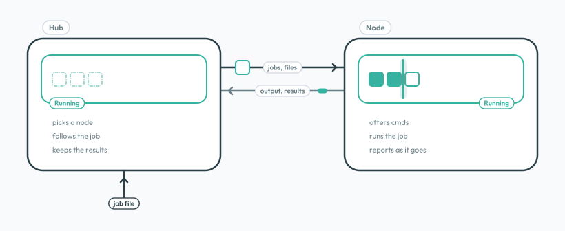

# grid

> Send jobs to machines you control, and get the results back

grid has two sides, talking over one protocol:

- the **hub** takes your jobs, picks where each one runs, and keeps the results;
- a **node** is a machine, container, or VM that offers a fixed set of commands and runs jobs with them.



## Why

You have machines that should do certain work for you: build, test, render, train, convert. You want to send them that work from somewhere else, without handing out shell access or running a CI server. grid does exactly that.

- **Fixed work, not a shell.** A node runs only the commands its own config names; a job can add `args` and `env`, never new commands. Compared with SSH, nobody gets a shell.
- **One port, no certificates.** Hub and node talk over one TCP port, `9420`, encrypted end to end. Each side trusts only the other's public key, from a known IP; no domains, no CA, no shared secret.
- **Files in, results out.** A job pushes your files to the node and pulls the results back to the hub. You watch the output live while it runs.
- **It keeps going.** A lost node means the job runs again on another one; a broken transfer resumes; a restarted hub picks its jobs up where they were.
- **One binary, an open protocol.** `grid` runs either side, as a binary or a Docker image. The protocol is written down byte for byte in [`spec/SPEC.md`](https://github.com/diphyx/grid/blob/HEAD/spec/SPEC.md): a hub or node of your own, in any language, works with them once it passes the [test kit](protocol.md#test-kit).

## How

A **job** is a request, not code: it picks from the node's **cmds**, pushes your files in, runs those cmds on them, and pulls the results back. The [Job](job.md) page shows how.

1. You submit a job to the hub.
2. The hub picks a node that offers the job's **tag** (a kind of work, like `build`) and has room for one more job, under its `[jobs] limit`.
3. The node makes a **space**, the job's own folder, and the hub pushes the files in.
4. The node runs the job's **steps**, its chosen cmds, one after another, sending each line of output as it goes.
5. The hub pulls the files back, and the node deletes the space.

Nodes do the work; the hub makes the decisions.


## Where It Sits

grid sits between SSH and a cluster: more than SSH (fixed commands, files moved for you, retries), much lighter than Slurm or Kubernetes.

|                   | SSH, Ansible           | **grid**                  | Slurm               | Kubernetes         |
| ----------------- | ---------------------- | ------------------------- | ------------------- | ------------------ |
| **What runs**     | any command            | the node's fixed commands | any batch script    | any container      |
| **Files**         | you copy them          | in and out with the job   | a shared filesystem | volumes            |
| **While it runs** | your terminal          | live output and events    | log files           | logs               |
| **Connection**    | SSH                    | one port, encrypted       | inside the cluster  | inside the cluster |
| **Where**         | machines you log in to | containers, LAN, internet | the cluster         | the cluster        |
| **To set up**     | SSH access             | one binary per side       | a cluster           | a cluster          |

Slurm and Kubernetes do much more: sharing a cluster's resources among many users, keeping services up and scaling them. grid does not try to. In short:

| Good fit                                                                          | Not a fit                                                         |
| --------------------------------------------------------------------------------- | ----------------------------------------------------------------- |
| builds, tests, conversions, renders, model runs: work that starts, runs, and ends | long-running services: a job is meant to finish                   |
| sending work to machines you own, on any network                                  | an interactive shell, or running arbitrary commands               |
| a few to many workers, each offering what it is good at                           | scheduling on its own: there is no cron; call `submit` from yours |
| keeping each job in its own clean folder                                          | splitting one job across many nodes: a job runs on one            |

## Deploy

The same protocol works in every setup; only the IPs and what you open change.

| Setup                            | IPs in the configs | Open TCP `9420`                                                |
| -------------------------------- | ------------------ | -------------------------------------------------------------- |
| one machine, containers          | container IPs      | nothing; they share a Docker network                           |
| local network, several machines  | private IPs        | on each node to the hub; on the hub to the nodes with `signal` |
| public network, several machines | public IPs         | the same, but only to the other side's IP                      |

Drawings and configs for each: [Deploy](deploy.md).

## Start

[Get Started](start.md) goes from nothing to a first job's results: install `grid`, make the keys, set up a node and a hub, and run a job.

```bash
brew install diphyx/tap/grid
```
