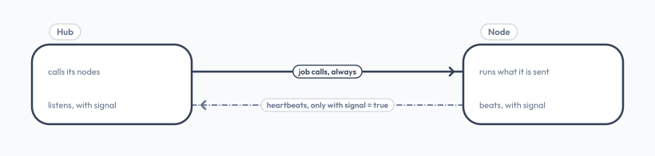
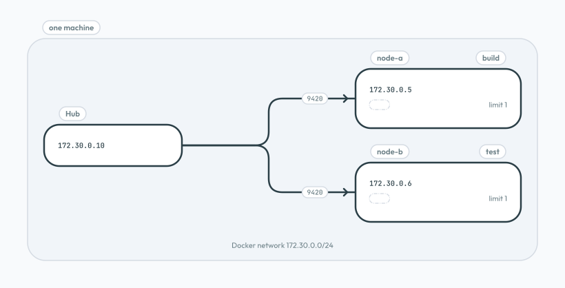
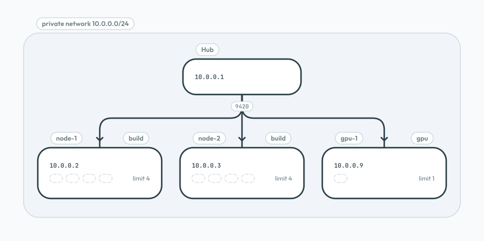
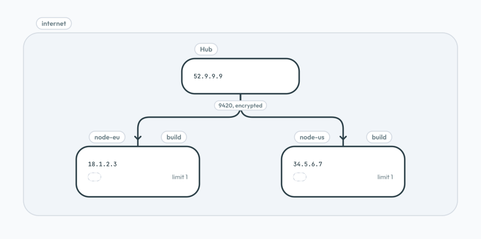

# Deploy

> One protocol for every setup: what changes is only the IPs and what you open

The hub always connects to its nodes on TCP `9420`. With `signal = true`, nodes also connect back to the hub. Everything else (keys, configs, jobs) is the same in every setup.



## One Machine, Containers

The hub and its nodes run as containers on one Docker network. Each container has its own IP, so all of them use port `9420`, and nothing is exposed outside the machine.



**Use it for:** isolating builds or tests on one server, or trying grid out.

```toml
# hub.toml: the nodes by their container IPs
[[nodes]]
ip = "172.30.0.5"
tags = ["build"]
trust = "/etc/grid/node-a.pub"
```

```toml
# node.toml: the hub by its container IP
[[hubs]]
ip = "172.30.0.10"
trust = "/etc/grid/hub.pub"
```

**Open:** nothing. The containers reach each other on the Docker network.

```yaml
# compose.yaml
services:
  hub:
    image: ghcr.io/diphyx/grid-hub
    volumes:
      - ./hub:/etc/grid:ro          # hub.toml, hub.key, node.pub, build.toml
      - hub-data:/var/lib/grid
    networks:
      grid:
        ipv4_address: 172.30.0.10

  node:
    build: ./node                   # FROM ghcr.io/diphyx/grid-node, plus its cmds (see Node)
    volumes:
      - ./node:/etc/grid:ro         # node.toml, node.key, hub.pub
      - node-data:/var/lib/grid
    networks:
      grid:
        ipv4_address: 172.30.0.5

networks:
  grid:
    ipam:
      config:
        - subnet: 172.30.0.0/24

volumes:
  hub-data:
  node-data:
```

In `hub/hub.toml` the node is `ip = "172.30.0.5"`; in `node/node.toml` the hub is `ip = "172.30.0.10"`. The containers run as uid `100`, so let it read the private keys: `sudo chown 100 hub/hub.key node/node.key`. Then:

```sh
docker compose up -d
docker compose exec hub grid hub nodes
docker compose exec hub grid hub submit /etc/grid/build.toml --wait
```

## Local Network, Several Machines

The hub and the nodes are machines on one private network: an office LAN, or a cloud VPC.



**Use it for:** spreading work over a few machines. Give nodes the same tag to share a kind of work; give special machines their own tag, like `gpu`, so only matching jobs go there.

```toml
# hub.toml: one [[nodes]] entry per machine
[[nodes]]
ip = "10.0.0.2"
tags = ["build"]
trust = "/etc/grid/node-1.pub"
```

| On        | Open TCP `9420` to                          |
| --------- | ------------------------------------------- |
| each node | the hub, `10.0.0.1`                         |
| the hub   | the nodes, only if they use `signal = true` |

## Public Network, Several Machines

The hub and the nodes are servers with public IPs, in different places or clouds. The protocol is the same; the traffic is encrypted end to end, and each side accepts only the IPs and keys in its config.



**Use it for:** machines that do not share a network, like a GPU server at one provider and build servers at another.

```toml
# hub.toml
[[nodes]]
ip = "18.1.2.3"
tags = ["build"]
trust = "/etc/grid/node-eu.pub"
```

| On        | Open TCP `9420` to                                        |
| --------- | --------------------------------------------------------- |
| each node | the hub's IP only, `52.9.9.9`                             |
| the hub   | the nodes' IPs only, and only if they use `signal = true` |

> **Each node needs an address the hub can reach.** The hub connects to the node, so a node behind NAT needs a public IP or a forwarded port. grid does not work around firewalls or NAT; opening them is up to you.
